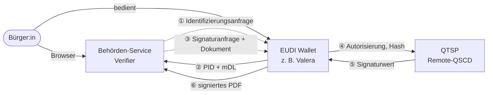
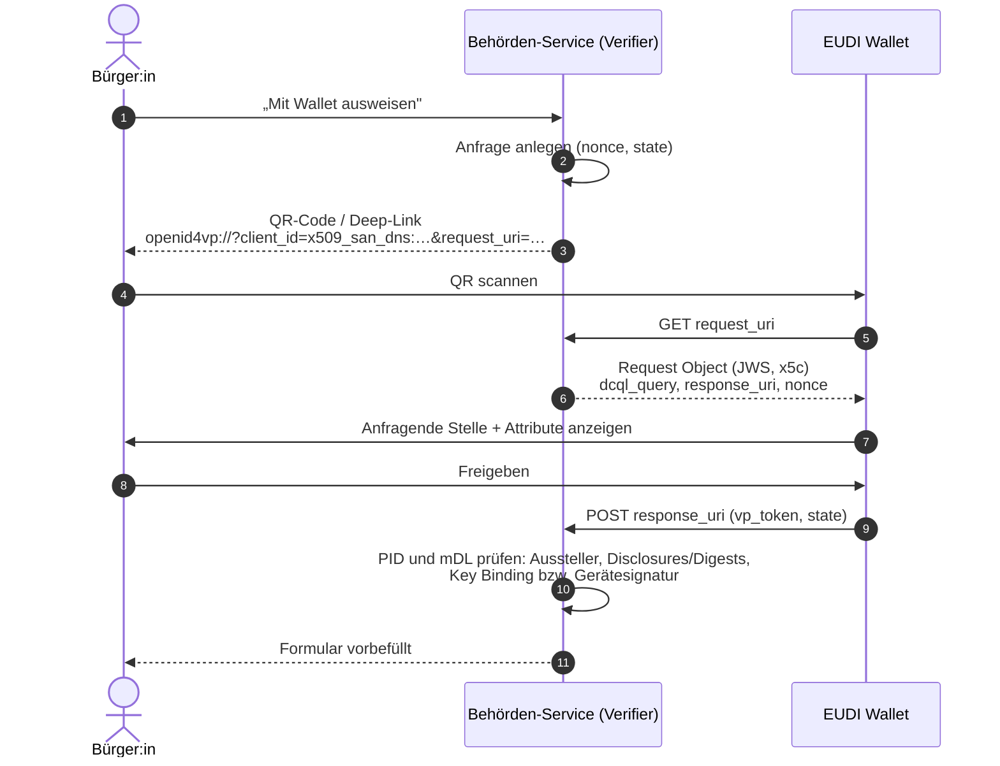
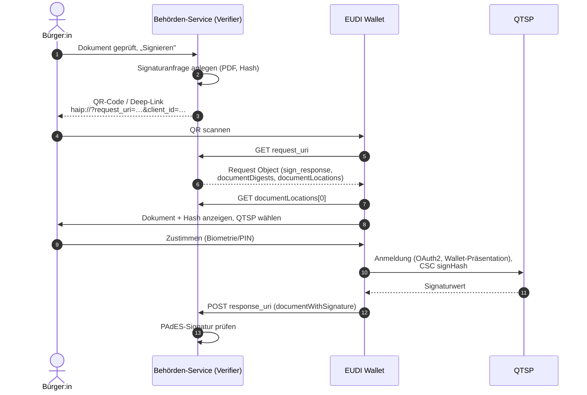
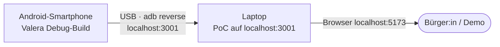

# Integrationsleitfaden: Ausweisen und Signieren mit der EUDI Wallet

> **Zielgruppe:** Behörden, IT-Dienstleister und Fachverfahrens-Verantwortliche, die Identifizierung und qualifizierte Signatur mit der European Digital Identity Wallet (EUDIW) in ihre Online-Services einbauen wollen.
>
> **Grundlage:** Proof of Concept „Digitales Amt Musterland" mit drei Beteiligten: **Behörden-Service** (Verifier), **EUDI Wallet** und **QTSP**. Getestet mit der [Valera Wallet 5.9.1](https://github.com/a-sit-plus/valera/releases/tag/5.9.1) von A-SIT Plus. Der Behörden-Service läuft lokal (`localhost`) oder öffentlich hinter TLS.
>
> **Stand:** November 2026

---

## 1. Auf einen Blick

Mit eIDAS 2.0 (Verordnung (EU) 2024/1183) erhalten alle Bürger:innen eine EUDI Wallet. Sie kann zwei Dinge, die Behörden-Services unmittelbar nutzen können:

1. **Ausweisen:** Die Wallet legt Personenidentifizierungsdaten (PID) und optional den mobilen Führerschein (mDL) vor, kryptografisch geprüft und datensparsam. Formulare müssen nicht mehr abgetippt werden.
2. **Unterschreiben:** Die Wallet autorisiert eine **qualifizierte elektronische Signatur (QES)**. Sie ist der handschriftlichen Unterschrift rechtlich gleichgestellt (Art. 25 Abs. 2 eIDAS).

**Was dieser PoC zeigt:**

| Schritt | Was passiert | Standard |
|---|---|---|
| 1. Ausweisen | Behörde fragt PID und (optional) mobilen Führerschein ab, Wallet legt beide in einem Schritt vor, Behörde prüft sie | OpenID4VP 1.0, DCQL, SD-JWT VC, ISO 18013-5 (mDL) |
| 2. Antrag ergänzen | Personen- und Führerscheindaten sind vorbefüllt und schreibgeschützt; nur Reiseziel und Zustellung werden gewählt | – |
| 3. Dokument erzeugen | Behörden-Service erzeugt das Antrags-PDF | PDF/A, WYSIWYS |
| 4. Signieren | Signaturanfrage mit Dokument-Hash, die Wallet lässt beim QTSP signieren | OpenID4VP (`sign_response`), ETSI TS 119 432, CSC API 2.0 |
| 5. Prüfen & Einbringen | Behörde prüft die PAdES-Signatur und nimmt den Antrag an | PAdES (ETSI EN 319 142), ETSI EN 319 102-1 |

> **Kernaussage für Entscheider:innen:** Beide Wallet-Interaktionen folgen demselben Muster: **Anfrage erzeugen → QR-Code zeigen → Antwort der Wallet entgegennehmen → prüfen.** Die Behörde betreibt dafür nur ihren eigenen **Behörden-Service**. Er stellt beide Anfragen und prüft beide Antworten; die Signatur selbst erzeugt der QTSP im Auftrag der Wallet.

---

## 2. Rollen und Architektur



| Rolle | Aufgabe | Im PoC |
|---|---|---|
| **Behörden-Service** (Verifier) | Stellt die OpenID4VP-Anfrage für PID und mDL und prüft die Antwort; erzeugt das Dokument, stellt die Signaturanfrage, nimmt das signierte PDF entgegen und prüft die Signatur | `server/src/` (Identifizierung in `verifier/`, Signaturanfrage in `signing/`), Web-GUI |
| **EUDI Wallet** | Zeigt Anfragen an, legt PID und mDL vor, holt beim QTSP die Signatur ein | Valera 5.9.1 oder eingebauter Simulator |
| **QTSP** (qualifizierter Vertrauensdiensteanbieter) | Stellt das qualifizierte Zertifikat aus und erzeugt den Signaturwert (Remote-QSCD, CSC API) | In der Wallet konfiguriert (siehe Abschnitt 7) |

**Architekturprinzipien**

- **Alles, was die Wallet aufruft, gehört der Behörde:** `request_uri`, `response_uri` und der Dokumentabruf liegen auf dem eigenen Host. Der Status muss nicht bei Dritten abgefragt werden.
- **Das Backend vertraut nur geprüften Daten:** Personendaten im Antrag übernimmt der Server direkt aus der verifizierten PID, nicht aus dem Browser.
- **Kein Draht zum QTSP:** Der Behörden-Service spricht nie mit dem QTSP. Die Wallet holt die Signatur ein und liefert das signierte Dokument zurück; welcher QTSP es war, steht im Zertifikat der Signatur.

---

## 3. Ablauf im Detail

### 3.1 Ausweisen (PID und mDL)



### 3.2 Signieren (wallet-zentrierte Fernsignatur)



---

## 4. Schritt-für-Schritt-Integration

### Schritt 1 – Voraussetzungen klären

**Organisatorisch**

- **Use-Case auswählen:** Verfahren, die eine Identifizierung und eine Unterschrift verlangen (Anträge, Erklärungen, Vollmachten).
- **Registrierung als Wallet-Relying-Party:** Vertrauende Parteien müssen sich im Mitgliedstaat registrieren (Durchführungsverordnung (EU) 2025/848). Sie erhalten ein **Zugangszertifikat** (WRPAC), mit dem sie ihre Anfragen signieren, und ein Registrierungszertifikat, das die erlaubten Attribute festlegt.
- **Datenminimierung:** Nur die PID-Attribute anfragen, die das Verfahren wirklich braucht, und sie in der Registrierung angeben. Wallets warnen bei mehr angefragten Attributen.
- **QTSP-Frage klären:** Im wallet-zentrierten Ablauf wählt die Wallet den QTSP. Dokumentieren Sie, welche QTSPs Ihre Zielgruppe nutzt.
- **Datenschutz:** DSFA und Verarbeitungsverzeichnis um die PID-Verarbeitung ergänzen.

**Technisch**

- HTTPS-Host mit DNS-Namen, der im SAN des Zugangszertifikats steht (`client_id = x509_san_dns:<host>`).
- Öffentlich erreichbare Endpunkte je Anfrage: `request_uri` (GET) und `response_uri` (POST), bei der Signatur zusätzlich der Dokumentabruf.
- Für die PID-Prüfung die Trust-Anker der PID-Provider (EU Trusted Lists), für die Signaturprüfung ein Validierungsdienst (z. B. EU DSS).

### Schritt 2 – PID und mDL anfragen

Der Behörden-Service erzeugt pro Vorgang `nonce` und `state` und signiert ein **Request Object** (JAR, RFC 9101) mit dem Zugangszertifikat:

```json
{
  "response_type": "vp_token",
  "client_id": "x509_san_dns:amt.example.gv.at",
  "response_mode": "direct_post",
  "response_uri": "https://amt.example.gv.at/oid4vp/response/7f3c…",
  "nonce": "Jx8n…",
  "state": "c2e1…",
  "dcql_query": {
    "credentials": [{
      "id": "pid",
      "format": "dc+sd-jwt",
      "meta": { "vct_values": ["urn:eudi:pid:1"] },
      "claims": [
        { "path": ["given_name"] }, { "path": ["family_name"] },
        { "path": ["birthdate"] }, { "path": ["place_of_birth"] },
        { "path": ["nationalities"] }, { "path": ["address"] }
      ]
    }, {
      "id": "mdl",
      "format": "mso_mdoc",
      "meta": { "doctype_value": "org.iso.18013.5.1.mDL" },
      "claims": [
        { "path": ["org.iso.18013.5.1", "document_number"] },
        { "path": ["org.iso.18013.5.1", "issuing_authority"] },
        { "path": ["org.iso.18013.5.1", "driving_privileges"] },
        { "path": ["org.iso.18013.5.1", "expiry_date"] }, …
      ]
    }],
    "credential_sets": [
      { "options": [["pid"]] },
      { "options": [["mdl"]], "required": false }
    ]
  },
  "client_metadata": {
    "vp_formats_supported": {
      "dc+sd-jwt": { "sd-jwt_alg_values": ["ES256"], "kb-jwt_alg_values": ["ES256"] },
      "mso_mdoc": { "issuerauth_alg_values": [-7], "deviceauth_alg_values": [-7] }
    }
  }
}
```

Die PID ist Pflicht, der mobile Führerschein (mDL) optional (`required: false`). Fehlt er, ermittelt die Behörde Führerscheinnummer, ausstellende Behörde und Klassen selbst aus dem Führerscheinregister.

JWS-Header: `{"alg":"ES256","typ":"oauth-authz-req+jwt","x5c":["<Zugangszertifikat>"]}`

Wallet-Aufruf als QR-Code und Deep-Link:

```
openid4vp://?client_id=x509_san_dns%3Aamt.example.gv.at&request_uri=https%3A%2F%2Famt.example.gv.at%2Foid4vp%2Frequest%2F7f3c…&request_uri_method=get
```

`request_uri_method=get` ist der Standard und könnte entfallen; der PoC setzt ihn ausdrücklich. Bei `post` schickt die Wallet ihre `wallet_metadata` und eine `wallet_nonce` an die `request_uri`; der Verifier spiegelt die `wallet_nonce` im Request Object zurück.

> Die Wallet prüft dabei, ob die Anfrage gültig signiert ist, ob der Hostname der `client_id` im Zertifikat steht und ob die `response_uri` auf denselben Host zeigt. Ein falsch konfigurierter Host ist der häufigste Integrationsfehler.

### Schritt 3 – Antwort prüfen (PID und mDL)

Die Wallet sendet per `direct_post` (form-urlencoded) `vp_token` und `state`. Bei OpenID4VP 1.0 ist `vp_token` ein JSON-Objekt `{"pid": ["<SD-JWT-Präsentation>"], "mdl": ["<DeviceResponse, base64url>"]}`.

Prüfungen für die PID (`server/src/verifier/sdjwt.ts`):

| Prüfung | Zweck |
|---|---|
| `state` passt zur Sitzung, Sitzung ist noch offen | Antwort gehört zu dieser Anfrage; ein abgeschlossener Vorgang wird nicht überschrieben |
| Signatur des Ausstellers (x5c), Zertifikat zeitlich gültig | PID ist echt und unverändert. Eine PID ohne prüfbare Ausstellersignatur wird abgelehnt. |
| Aussteller vertrauenswürdig | PID stammt von einem anerkannten PID-Provider. Produktiv: EU Trusted List. **Im PoC: feste Liste** der Aussteller-Zertifikate (`server/src/verifier/trust.ts`). |
| `vct = urn:eudi:pid:1`, `exp`, `nbf` | richtiger Typ, gültig |
| Disclosures passen zu den `_sd`-Hashes | nur echte Attribute werden übernommen |
| Key-Binding-JWT: Signatur mit `cnf`-Schlüssel | Präsentation kommt vom Gerät der Inhaber:in |
| Key-Binding: `nonce`, `aud = client_id`, `sd_hash`, `iat` | kein Replay, für genau diesen Verifier |

Prüfungen für den mDL (`server/src/verifier/mdoc.ts`):

| Prüfung | Zweck |
|---|---|
| IssuerAuth: COSE_Sign1 mit Zertifikat aus `x5chain` | mDL ist echt und unverändert |
| Aussteller vertrauenswürdig | mDL stammt von einer Führerscheinbehörde. Produktiv: Trust-Anker der Aussteller (IACA). **Im PoC: feste Liste.** |
| `docType` und `validityInfo` des Mobile Security Object (MSO) | richtiger Nachweis, gültig |
| SHA-256 jedes `IssuerSignedItem` steht in `valueDigests` | nur echte Datenelemente werden übernommen |
| DeviceAuth: Gerätesignatur über das SessionTranscript (`OpenID4VPHandover` aus `client_id`, `nonce`, `response_uri`) | Präsentation kommt vom Gerät, kein Replay, für genau diesen Verifier |
| Name und Geburtsdatum im mDL = PID | beide Nachweise gehören zur selben Person |

Danach bildet der Behörden-Service die Claims auf seine Daten ab (`given_name` → Vorname, `address.street_address` + `house_number` → Straße, `driving_privileges` → Klassen usw.) und **übernimmt sie serverseitig in den Antrag**.

> **Grundsatz:** Daten, die die Behörde selbst vergibt oder führt (Führerscheinnummer, ausstellende Behörde, Klassen), werden nie von der Antragstellerin eingegeben – sie kommen geprüft aus der Wallet oder aus dem Register. Auch Kontaktdaten wie eine E-Mail-Adresse fragt der PoC nicht ab: Die Zustellung läuft über das Bürgerportal.

### Schritt 4 – Das zu signierende Dokument erzeugen

- Dokument **serverseitig** aus den Daten erzeugen, idealerweise als **PDF/A**.
- Genau dieses Dokument vor der Signatur anzeigen („What You See Is What You Sign").
- Den **SHA-256-Hash** berechnen. Er erscheint in der Wallet (`documentDigests`) und dient als Nachweis.

### Schritt 5 – Signaturanfrage erstellen

Der Behörden-Service signiert ein Request Object, das statt Daten eine Signatur anfordert:

```json
{
  "response_type": "sign_response",
  "client_id": "x509_san_dns:amt.example.gv.at",
  "response_mode": "direct_post",
  "response_uri": "https://amt.example.gv.at/sign/response/91ab…",
  "nonce": "…",
  "state": "…",
  "signatureQualifier": "eu_eidas_qes",
  "documentDigests": [{ "hash": "FOtLnxtLPuMkX8v+zJGSOOMrQd/GiuboYeGif7dCrFk=", "label": "Antrag.pdf" }],
  "documentLocations": [{ "uri": "https://amt.example.gv.at/sign/document/91ab…", "method": { "type": "public" } }],
  "hashAlgorithmOID": "2.16.840.1.101.3.4.2.1"
}
```

| Parameter | Erklärung |
|---|---|
| `response_type: sign_response` | Signaturauftrag, keine Datenabfrage |
| `signatureQualifier: eu_eidas_qes` | Verlangt eine **qualifizierte** Signatur |
| `documentDigests` | Hash (Base64) und Bezeichnung jedes Dokuments |
| `documentLocations` | Wo die Wallet das Dokument lädt. `public` bedeutet ohne Zugangsschutz, daher die URL unratbar machen und zeitlich begrenzen |
| `hashAlgorithmOID` | `2.16.840.1.101.3.4.2.1` = SHA-256 |
| `response_uri` | Ziel für das signierte Dokument. `state` wird als Query-Parameter angehängt |

Wallet-Aufruf: `haip://?request_uri=<…/sign/createSignRequest/91ab…>&client_id=x509_san_dns%3Aamt.example.gv.at`.

> **Hinweis Valera:** Die `request_uri` muss den Pfadbestandteil `createSignRequest` enthalten. Daran erkennt Valera einen von außen (Kamera, Browser) geöffneten Link als Signaturanfrage; sonst behandelt es ihn als normale Datenabfrage.

### Schritt 6 – Signiertes Dokument entgegennehmen

Die Wallet postet an die `response_uri` (form-urlencoded) das Feld `documentWithSignature`. Es enthält ein JSON-Array mit Base64-kodierten, signierten PDFs. Der Behörden-Service prüft `state`, dekodiert das PDF und speichert es **unverändert**. Er nimmt nur die erste Antwort an: Ist der Vorgang abgeschlossen, lässt sich das signierte Dokument nicht mehr ersetzen.

### Schritt 7 – Signatur prüfen

| Prüfung | Wie | Im PoC |
|---|---|---|
| Integrität | Hash über `/ByteRange` = `messageDigest` im CMS | ✅ |
| Kryptografische Gültigkeit | Signaturwert mit dem Zertifikatsschlüssel prüfen | ✅ |
| Vollständigkeit | `/ByteRange` deckt die ganze Datei ab | ✅ |
| Format | `SubFilter = ETSI.CAdES.detached` (PAdES) | ✅ |
| Qualifiziertes Zertifikat | QCStatement `QcCompliance` (0.4.0.1862.1.1) | ✅ |
| QSCD | QCStatement `QcSSCD` (0.4.0.1862.1.4) | ✅ |
| Kette zur EU Trusted List, Sperrstatus | OCSP/CRL, Trusted List | ➜ Validierungsdienst |
| Identität | Unterzeichner:in = ausgewiesene Person (Name, Geburtsdatum aus der PID) | fachlich |

Der Behörden-Service prüft die Signatur beim Einbringen selbst noch einmal und verlässt sich nicht auf die Anzeige im Browser.

Empfohlen für den Produktivbetrieb: [EU DSS](https://github.com/esig/dss) als eigener Dienst, für manuelle Kontrollen die [RTR-Signaturprüfung](https://www.signaturpruefung.gv.at/).

### Schritt 8 – Weiterverarbeiten und archivieren

- Signiertes PDF, Prüfprotokoll und PID-Prüfergebnis gemeinsam im Akt ablegen.
- Für Langzeitbeweiswert auf **PAdES-B-LTA** erweitern.
- Eingangsbestätigung mit Geschäftszahl und Dokument-Hash versenden.

---

## 5. Referenzimplementierung (dieser PoC)

```
Wallet-Signatur-PoC/
├─ server/src/
│  ├─ index.ts                  REST-API des Behörden-Service + Endpunkte für die Wallet
│  ├─ config.ts                 PUBLIC_URL, client_id, Laufzeiten
│  ├─ verifier/                 Identifizierung: OpenID4VP-Anfrage und Prüfung (PID und mDL)
│  │  ├─ verifier.ts            Anfrage, Request Object, Antwortverarbeitung
│  │  ├─ sdjwt.ts               SD-JWT-VC-Prüfung inkl. Key Binding
│  │  ├─ mdoc.ts                mDL-Prüfung (ISO 18013-5, COSE, SessionTranscript)
│  │  └─ pid.ts                 DCQL-Abfrage, Abbildung PID → Formular
│  ├─ signing/signing.ts        Signaturanfrage an die Wallet, Entgegennahme des signierten PDF
│  ├─ crypto/                   JWS-Hilfen, lokale Zertifikate (.data/)
│  ├─ register.ts               Führerscheinregister (Stub, falls kein mDL vorgezeigt wird)
│  ├─ simwallet/                Wallet-Simulator (Test-PID, Test-mDL, Test-Signatur)
│  ├─ pdf.ts                    Antrags-PDF
│  └─ validate.ts               PAdES-Prüfung
├─ web/src/                     React-Oberfläche
└─ docs/Integrationsleitfaden.md
```

### Endpunkte, die die Wallet aufruft

| Methode | Pfad | Zweck |
|---|---|---|
| `GET` | `/oid4vp/request/:id` | Request Object der PID-Anfrage |
| `POST` | `/oid4vp/request/:id` | Request Object bei `request_uri_method=post` (`wallet_nonce` wird zurückgespiegelt) |
| `POST` | `/oid4vp/response/:id` | `vp_token` der Wallet |
| `GET` | `/sign/createSignRequest/:id` | Request Object der Signaturanfrage |
| `GET` | `/sign/document/:id` | Zu signierendes Dokument |
| `POST` | `/sign/response/:id` | `documentWithSignature` der Wallet |

### REST-API des Behörden-Service (Browser → Backend)

| Methode | Pfad | Zweck |
|---|---|---|
| `POST` | `/api/identifications` | PID-Anfrage starten → Deep-Link + QR |
| `GET` | `/api/identifications/:id` | Status, verifizierte PID, Prüfschritte |
| `POST` | `/api/presentations` | Präsentationsanfrage mit eigenen Parametern (Transaktions-API, siehe unten) |
| `GET` | `/api/presentations/:id` | wie `/api/identifications/:id` |
| `POST` | `/api/applications` | Antrag anlegen (`identificationId` übernimmt die PID) |
| `POST` | `/api/applications/:id/sign` | Signaturanfrage starten → Deep-Link + QR |
| `GET` | `/api/applications/:id/status` | Signaturstatus + Protokoll |
| `GET` | `/api/applications/:id/validation` | Prüfbericht der Signatur |
| `POST` | `/api/applications/:id/submit` | Antrag einbringen |

> **Zwei Kennungen pro Vorgang:** Die Kennung in `request_uri` und `response_uri` steht im QR-Code und ist für alle sichtbar, die ihn sehen (Beamer, Screenshot). Das Ergebnis mit den Personendaten gibt es deshalb nur über eine zweite Kennung, die allein der Behörden-Service kennt (`id` bzw. `transaction_id`).

### Transaktions-API für Fachverfahren

`POST /api/presentations` nimmt die Parameter entgegen, wie man sie von Verifier-Backends kennt, und baut daraus das Request Object und den QR-Code. Alle Felder sind optional; ohne Body entspricht die Anfrage `/api/identifications`.

```json
{
  "nonce": "f1a24980-9535-4b31-bb67-52a9a9df35ef",
  "profile": "openid4vp",
  "request_uri_method": "get",
  "authorization_request_uri": "openid4vp://",
  "intended_use_id": "TEST-01",
  "dcql_query": { "credentials": [ … ], "credential_sets": [ … ] }
}
```

| Feld | Bedeutung | Standard |
|---|---|---|
| `dcql_query` | DCQL-Abfrage. Der PoC kann nur `pid` (`dc+sd-jwt`, Pflicht) und `mdl` (`mso_mdoc`) prüfen. | PID + optionaler mDL wie in Schritt 2 |
| `nonce` | Nonce für Key Binding bzw. SessionTranscript, 16–128 URL-sichere Zeichen | zufällige UUID |
| `profile` | nur `openid4vp` (HAIP mit verschlüsselter Antwort ist nicht umgesetzt) | `openid4vp` |
| `request_uri_method` | `get` oder `post` | `get` |
| `authorization_request_uri` | Schema bzw. Basis-URI des Wallet-Aufrufs, z. B. `openid4vp://`, `haip://` oder eine https-App-Link-URL | `openid4vp://` |
| `intended_use_id` | Kennung des registrierten Verwendungszwecks. Wird protokolliert, aber nicht an die Wallet geschickt – dafür gibt es im Request noch keinen festgelegten Parameter. | – |

Antwort: `transaction_id`, `authorization_request_uri` (fertiger Deep-Link), `request_uri`, `nonce`, `qrSvg`, `expiresInSec`. Ungültige Parameter liefern `400` mit `error_description`. Den Status fragt das Fachverfahren über `GET /api/presentations/:transaction_id` ab.

### Wallet-Simulator

Für Präsentationen ohne Smartphone enthält der PoC einen Wallet-Simulator. Er ruft **dieselben Protokoll-Endpunkte über HTTP** auf wie eine echte Wallet. Er prüft das Request Object, legt eine Test-PID als SD-JWT VC mit Key Binding vor und signiert mit einem Testzertifikat. Damit wird der komplette Ablauf auch im Demo-Modus durchlaufen. Das Ergebnis ist **keine QES**.

---

## 6. Testumgebung: alles auf localhost

Der Behörden-Service baut selbst keine Verbindung zu externen Diensten auf. Die Wallet am Smartphone erreicht ihn über `localhost`:



### Warum die Debug-APK?

Die Release-Version von Valera erlaubt nur HTTPS. Die **Debug-Version** erlaubt laut ihrer `network_security_config` unverschlüsseltes HTTP ausschließlich zu `localhost`. Genau das nutzt der PoC.

### Einrichtung

1. **Valera-Debug-APK** von der [Release-Seite](https://github.com/a-sit-plus/valera/releases/tag/5.9.1) installieren (`valera-debug-5.9.1.apk`).
2. **Test-PID (SD-JWT) und optional Test-mDL (ISO)** in die Wallet laden, zum Beispiel über den Test-Issuer von A-SIT Plus. Das ist ein einmaliger Schritt, unabhängig vom PoC.
3. Am Smartphone **USB-Debugging** aktivieren und das Gerät per Kabel verbinden.
4. Am Laptop die Android Platform Tools installieren und den Port weiterleiten:

```bash
brew install android-platform-tools
```

```bash
adb reverse tcp:3001 tcp:3001
```

5. PoC starten und http://localhost:5173 öffnen, Modus **„Valera-Smartphone"** wählen.

```bash
npm install && npm run dev
```

Alternativ funktioniert ein **Android-Emulator** mit derselben `adb reverse`-Weiterleitung.

| Umgebungsvariable | Standard | Bedeutung |
|---|---|---|
| `API_PORT` | `3001` | Port von API und Wallet-Endpunkten |
| `PUBLIC_URL` | `http://localhost:3001` | Basis-URL für `request_uri`/`response_uri`. Ihr Hostname ist die `client_id` und steht im SAN des Zertifikats |

Die Zertifikate (Request-Signer, Test-PID-Aussteller) erzeugt der PoC beim ersten Start selbst und legt sie unter `.data/` ab.

### Fehlerbehebung

| Symptom | Ursache / Lösung |
|---|---|
| Wallet meldet Netzwerkfehler | `adb reverse` aktiv? `adb reverse --list` prüfen. Release-APK statt Debug-APK installiert? |
| Wallet lehnt die Anfrage ab | Hostname der `client_id` nicht im Zertifikat-SAN, z. B. nach Änderung von `PUBLIC_URL`. `.data/` löschen und neu starten |
| PID-Prüfung schlägt bei „Key Binding" fehl | Uhrzeit von Laptop und Smartphone prüfen (`iat`) |
| Status bleibt „Anfrage bereit" | QR mit der richtigen Funktion scannen bzw. Link von außen öffnen (siehe unten) |
| Keine PID zur Auswahl | Die PID wird als SD-JWT VC angefragt; eine PID nur im ISO-Format passt nicht |
| Valera: „Signing callback received without an active signing flow" | Signatur-QR mit der **Handy-Kamera** (oder am Handy per Link) öffnen statt mit dem Scanner in Valera – in Valera 5.9.1 landen Start und Rücksprung vom QTSP sonst in verschiedenen Sitzungen |
| Terminal zeigt keine `[wallet]`-Zeilen | Die Wallet erreicht den PoC nicht (siehe erste Zeile) |

### Öffentlicher Betrieb

Für Demos ohne Kabel läuft derselbe PoC hinter einem Reverse Proxy mit TLS, z. B. unter `https://wallet-demo.a-sit.at/`. Dann gilt:

- `PUBLIC_URL=https://wallet-demo.a-sit.at` setzen. Die `client_id` wird `x509_san_dns:wallet-demo.a-sit.at`, das Request-Zertifikat erhält diesen SAN. Auch ein Pfad unter einer bestehenden Domain funktioniert (z. B. `https://amt.example.gv.at/wallet-demo`).
- Die normale Valera-App genügt; `adb reverse` und die Debug-APK entfallen.
- Das Request-Zertifikat ist selbstsigniert. Valera zeigt daher eine Warnung („kein Access-Zertifikat“). Im Produktivbetrieb verwenden Sie ein Zugangszertifikat (WRPAC) Ihres Registrars.
- Anträge und PID-Daten liegen nur im Arbeitsspeicher und werden nach `RETENTION_MINUTES` gelöscht.

Vorlagen für den Reverse Proxy (Apache-vHost mit Let's Encrypt) und den Dienst (systemd) liegen im Ordner `deploy/` des PoC.

---

## 7. Grenzen des PoC

- **QTSP (remote, so gewollt):** Der QTSP ist ein externer Vertrauensdienst und läuft bewusst remote; die Liste der QTSPs ist in der Wallet konfiguriert. Bei einer echten Signatur spricht **die Wallet** direkt mit dem QTSP. Der Behörden-Service hat keine Verbindung zum QTSP: Er liefert nur das Dokument und empfängt das signierte PDF.
- **Rücksprung vom QTSP:** Nach der Anmeldung beim QTSP öffnet die Wallet dessen `redirect_uri`. Valera (VC-K) akzeptiert dort nur `https`-Adressen. Ein QTSP, der direkt auf ein App-Schema (`asitplus-wallet://…`) zurückleitet, braucht eine https-Zwischenseite; der PoC bietet dafür `/wallet-callback/…` an (Vorlage `deploy/apache-qtsp-callback.conf`).
- **Vertrauen:** Bei PID und mDL akzeptiert der PoC nur Aussteller aus einer festen Liste von Zertifikaten (die Test-Aussteller, mit denen er erprobt ist; erweiterbar über `TRUSTED_ISSUERS`). Die Kette zur EU Trusted List prüft er nicht, auch nicht für das Zertifikat des QTSP. Im Produktivbetrieb ist das Pflicht.
- **Zertifikat:** Der Request-Signer ist selbst ausgestellt. Wallets mit Trust-Prüfung, etwa neuere Valera-Versionen mit eIDAS-Dashboard-Abgleich, fragen deshalb gegebenenfalls nach. Produktiv wird das registrierte Zugangszertifikat verwendet.
- **Schrift im Antrags-PDF:** Eingebettet ist Liberation Sans (lateinische Schrift mit Erweiterungen, Griechisch, Kyrillisch), damit Namen wie „Łukasz Dvořák“ unverändert im signierten Dokument stehen. Zeichen außerhalb davon (etwa CJK) erscheinen als „?“.
- **Persistenz:** Anträge und Sitzungen liegen nur im Speicher.

---

## 8. Sicherheit und Datenschutz

- [ ] Request Objects **immer signiert** (`x5c`), `client_id` an den eigenen Hostnamen gebunden, `response_uri` auf demselben Host.
- [ ] `nonce` und `state` pro Vorgang zufällig erzeugen, serverseitig speichern und prüfen.
- [ ] Key Binding der PID prüfen (`nonce`, `aud`, `sd_hash`). Ohne diese Prüfung ist ein Replay möglich.
- [ ] Nachweise ohne prüfbare Ausstellersignatur oder von unbekannten Ausstellern ablehnen – „nicht prüfbar“ ist nicht „gültig“. Ein selbst ausgestelltes Zertifikat kann jeden Namen tragen.
- [ ] Die Kennung im QR-Code (`request_uri`) von der Kennung trennen, über die das Ergebnis abgerufen wird.
- [ ] Antworten der Wallet nur für offene Vorgänge und mit passendem `state` annehmen; ein falscher `state` darf den Vorgang nicht abbrechen.
- [ ] Eingaben aus dem Browser prüfen (Typ, Länge) und Fehler abfangen, damit ein einzelner Aufruf den Dienst nicht beendet.
- [ ] Verifizierte Daten **serverseitig** übernehmen, nie aus dem Browser.
- [ ] Nur benötigte Attribute anfragen und in der RP-Registrierung angeben.
- [ ] `documentLocations` nicht erratbar und kurzlebig gestalten.
- [ ] Kette angezeigter Hash = `documentDigests` = signierter Inhalt protokollieren.
- [ ] Signaturprüfung inkl. Trusted List und Sperrstatus **vor** der Einbringung – serverseitig, nicht nur als Anzeige.
- [ ] Logs ohne personenbezogene Inhalte.

---

## 9. UX-Empfehlungen

1. **Ausweisen zuerst:** Wer sich mit der Wallet ausweist, muss nichts abtippen. Verifizierte Felder als geprüft kennzeichnen und sperren.
2. **Amtliche Daten nie abfragen:** Was die Behörde vergibt oder im Register hat (Nummern, Klassen, ausstellende Stelle), kommt aus der Wallet oder dem Register – nicht aus einem Eingabefeld. Keine überflüssigen Kontaktdaten (z. B. E-Mail) erheben.
3. **Manuellen Weg anbieten:** „Ohne Wallet fortfahren" für Personen ohne Wallet.
4. **Dokument vor der Signatur zeigen.** Eine zusätzliche Checkbox ist nicht nötig: Die Zustimmung erteilt die Person in der Wallet, die das Dokument ebenfalls anzeigt.
5. **Gerätekontext erkennen:** Am Smartphone ist der Deep-Link die Hauptaktion, am Desktop der QR-Code.
6. **Live-Status:** zeigen, ob die Wallet die Anfrage erhalten hat.
7. **Klar sagen, welche Funktion der Wallet gemeint ist** („Vorzeigen" bzw. „Signieren").
8. **Barrierefreiheit:** QR-Code mit Textalternative, Same-Device-Weg als gleichwertige Option.

---

## 10. Go-Live-Checkliste

| Bereich | Punkt |
|---|---|
| Recht | Identifizierung über PID und Schriftform über QES im Materiengesetz zulässig? |
| Registrierung | Wallet-Relying-Party registriert, Zugangs- und Registrierungszertifikat vorhanden |
| Identifizierung | Trust-Anker der PID- und mDL-Aussteller (Trusted Lists) eingebunden, Sperrprüfung (Status List) |
| Behörden-Service | HTTPS, Laufzeiten, Monitoring, Dokumentabruf abgesichert |
| QTSP | Unterstützte QTSPs dokumentiert, Kostenfrage geklärt |
| Prüfung | Validierungsdienst (z. B. EU DSS) produktiv, Prüfprotokoll im Akt |
| Datenschutz | DSFA, Verarbeitungsverzeichnis, Informationspflichten |
| Test | Ende-zu-Ende mit mindestens zwei Wallets und zwei QTSPs |

---

## 11. Häufige Fragen

**Brauchen wir einen Tunnel oder einen Cloud-Dienst zum Testen?**
Nein. Mit dem Debug-Build von Valera und `adb reverse` läuft alles über `localhost`.

**Sieht die Behörde mehr Daten als nötig?**
Nein. Die DCQL-Abfrage nennt die Attribute einzeln, und die Wallet legt per Selective Disclosure nur diese offen.

**Kann der Führerschein selbst aus der Wallet kommen?**
Ja, und der PoC macht genau das: Der mDL (ISO 18013-5) wird in derselben DCQL-Abfrage wie die PID angefordert, optional. Führerscheinnummer, ausstellende Behörde und Klassen sind dann vorbefüllt und geprüft. Ohne mDL ermittelt sie die Behörde aus dem Register.

**Was passiert, wenn die Person in der Wallet ablehnt?**
Die Wallet meldet `error=access_denied`. Der Service zeigt das an und bietet eine neue Anfrage an.

---

## 12. Glossar

| Begriff | Bedeutung |
|---|---|
| **EUDIW** | European Digital Identity Wallet nach eIDAS 2.0 |
| **PID** | Person Identification Data: die digitale Identität in der Wallet |
| **SD-JWT VC** | Selective-Disclosure-JWT als Verifiable Credential: Format der PID |
| **DCQL** | Digital Credentials Query Language: Abfragesprache in OpenID4VP 1.0 |
| **Key Binding** | Nachweis, dass die Präsentation vom Gerät der Inhaber:in stammt |
| **QES** | Qualifizierte elektronische Signatur |
| **QTSP** | Qualified Trust Service Provider: erzeugt die qualifizierte Signatur |
| **Verifier** | Rolle des Behörden-Service gegenüber der Wallet: stellt Anfragen und prüft Antworten |
| **QSCD** | Qualifizierte Signaturerstellungseinheit, hier remote beim QTSP |
| **CSC API** | Schnittstelle des Cloud Signature Consortium für Remote-Signaturen |
| **OpenID4VP** | OpenID for Verifiable Presentations |
| **PAdES** | PDF Advanced Electronic Signatures (ETSI EN 319 142) |
| **WRPAC** | Wallet-Relying-Party Access Certificate (Zugangszertifikat) |

---

## 13. Referenzen

- Verordnung (EU) 2024/1183 (eIDAS 2.0) und Durchführungsverordnungen zur EUDI Wallet
- [EUDI Architecture and Reference Framework (ARF)](https://eudi.dev/)
- [OpenID for Verifiable Presentations 1.0](https://openid.net/specs/openid-4-verifiable-presentations-1_0.html)
- [IETF SD-JWT](https://datatracker.ietf.org/doc/draft-ietf-oauth-selective-disclosure-jwt/) und [SD-JWT VC](https://datatracker.ietf.org/doc/draft-ietf-oauth-sd-jwt-vc/)
- [Cloud Signature Consortium API](https://cloudsignatureconsortium.org/resources/download-api-specifications/)
- ETSI TS 119 432, ETSI EN 319 142 (PAdES), ETSI EN 319 102-1, ETSI EN 319 412-5
- [Valera Wallet](https://github.com/a-sit-plus/valera) · [EU DSS](https://github.com/esig/dss)
